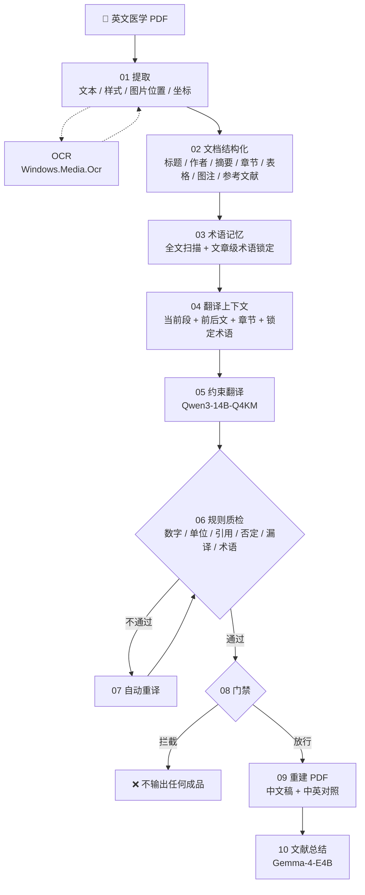

<div align="center">

CCMU # 医学文献翻译 Agent · v1.0

**英文医学 PDF → 中文译稿 · 中英对照 · 术语表 · 质检报告 · 文献总结** 一键生成

**本地化运行**


[功能](#功能) · [工作原理](#工作原理) · [快速开始](#快速开始) · [已知局限](#已知局限) · [相关项目](#相关项目)

</div>

---

## 先读这一段

<table>
<tr><td>

**本仓库只包含代码，不含模型权重，克隆下来不能直接运行。**

跑起来还需要约 **16 GB** 的模型，仓库里放不下（GitHub 单文件上限 100 MB）。
获取方式见 **[MODELS.example.md](MODELS.example.md)**。

</td></tr>
</table>

另外两点：

- **这是 v1.0 归档版**，排版引擎是最早的实现，存在已知缺陷（见[已知局限](#已知局限)）。
  日常使用建议用 v2.0 / v2.1。
- 仓库里的脚本按**自包含离线发行包**设计，路径写死为「版本文件夹内的 `runtime\`、`models\`」。
  用仓库代码跑需要自备 Python 环境并调整路径。

> 📜 **许可**：仅供学生与教学单位学习、教学、科研使用，**不得商用与修改**
> （CC BY-NC-ND 4.0）。详见[使用许可](#使用许可)。

---

## 功能

| 能力 | 说明 |
| :--- | :--- |
| 📄 **中文译稿** | 英文医学 PDF → 中文 PDF，逐块替换 |
| 🔁 **中英对照** | 输出原文与译文并列的对照 PDF |
| 📚 **文章级术语表** | 107 条种子术语硬锁定，同一篇内译名一致 |
| ✅ **自动质检** | 数字、单位、引用、否定关系、漏译、术语一致性逐条校验 |
| 🚫 **失败门禁** | 高风险内容块未通过质检 → **拦截最终输出**，不交付半成品 |
| 🔍 **扫描件 OCR** | 无文字层自动改用 Windows 自带识别引擎，全程离线 |
| 🖥️ **本地 WebUI** | 拖拽上传、阶段进度、实时日志、结果下载、历史任务 |
| 🔌 **完全离线** | 不联网、不上传、不自动下载模型 |

---

## 工作原理

十个可独立运行的阶段，每阶段产物落盘，方便单步调试：



**设计取舍：不设人工终审。** 取而代之的是 `规则质检 + 自动重译 + 失败门禁` ——
只要高风险内容块过不了自动质检，整份输出就被拦下，而不是交付一份看着像成品的东西。

---

## 快速开始

### 1. 准备模型

本仓库不含权重。按 **[MODELS.example.md](MODELS.example.md)** 准备三个模型：

| 用途 | 模型 | 体积 |
| :--- | :--- | ---: |
| 主翻译 | `Qwen3-14B-Q4KM:latest` | 8.38 GB |
| 复审 / 总结 | `Gemma-4-E4B:latest` | 5.75 GB |
| 预处理槽位（预留） | `deepseek-r1:1.5b` | 1.04 GB |

### 2. 启动 Ollama

**必须手动启动**，本项目不会自动拉起后台进程（原因见 [docs/OFFLINE.md](docs/OFFLINE.md)）：

```powershell
cd <v1.0 所在路径>
$env:OLLAMA_MODELS         = "$PWD\models\ollama"
$env:OLLAMA_LIBRARY_PATH   = "$PWD\runtime\ollama\lib\ollama"
$env:OLLAMA_HOST           = "127.0.0.1:11434"
$env:OLLAMA_MAX_LOADED_MODELS = "1"
$env:OLLAMA_NUM_PARALLEL      = "1"
& "$PWD\runtime\ollama\ollama.exe" serve
```

### 3. 跑流程

**WebUI（推荐）** —— 双击 `start.bat`，浏览器打开 <http://127.0.0.1:8765>，拖入 PDF。

**命令行**：

```powershell
.\run_offline.ps1 -InputPdf "data\input\paper.pdf"
```

**单步运行**（十个阶段各自独立）：

```powershell
.\runtime\python\python.exe 01_extract_pdf.py
.\runtime\python\python.exe 02_structure_document.py
# … 依此类推至 10_generate_summary.py
```

**跑测试**：

```powershell
.\runtime\python\python.exe -m unittest discover -s tests -v
```

---

## 项目结构

```text
v1.0/
├── 00_create_demo_pdf.py … 10_generate_summary.py   # 十个流水线阶段
├── src/med_agent/          # 核心代码
│   ├── pdf_extractor.py    #   提取（含 OCR 分支）
│   ├── document_structurer.py
│   ├── term_memory.py      #   术语锁定
│   ├── context_retriever.py
│   ├── ollama_client.py    #   模型调用
│   ├── quality_checker.py  #   质检规则
│   └── pdf_builder.py      #   重建 PDF
├── configs/                # ocr.json / models.json / 术语种子
├── prompts/                # Agent 提示词
├── webui/                  # 本地 WebUI（无外部前端依赖）
├── docs/                   # OFFLINE.md / WEBUI.md
├── tests/                  # 单元测试
├── tools/                  # 离线打包脚本
├── run_offline.ps1         # 命令行入口
└── start.bat               # WebUI 启动器
```

> `runtime/`、`models/`、`vendor/` 因体积原因未纳入仓库。

---

## 安全边界

- **全程不联网**：翻译、OCR、总结都在本机完成，不下载模型或语言包。
- **WebUI 只监听 `127.0.0.1`**，局域网与互联网设备无法访问；上传上限 300 MB。
- **OCR 用 Windows 自带识别引擎**，需系统已安装对应语言包。
- **译文由本地模型生成**，质检门禁只能拦住可规则化的问题（数字、单位、术语、否定关系等），
  **医学结论请自行复核。**

---

## 已知局限

> v1.0 的排版引擎是最早的实现，以下问题在 v2.0 / v2.1 中已修复。

| 局限 | 说明 |
| :--- | :--- |
| **图表、公式** | 覆盖块框内的一切 —— **公式会被擦掉** |
| **字号被压小** | 白底覆盖原文后逐块塞入，译文偏长时字号会被压缩 |
| **表格放不下** | 缩到最小字号，可能影响可读性 |
| **无翻译缓存** | 每次全量重译，重复内容零成本无法实现 |
| **一次一个** | 无目录批处理 |
| **无法取消** | 任务启动后不能中止 |
| **跨栏扫描件** | 双栏排版时识别引擎可能把左右栏同行后段并成一行，个别块会被质检拦截 |

OCR 相关实测（2 页扫描论文，段落合并前后）：

| 指标 | 逐行版本 | 段落版本 |
| :--- | ---: | ---: |
| 提取内容块 | 128 | 50 |
| 待翻译内容块 | 93 | 27 |
| 锁定术语 | 0 | 25 |

---

## 相关项目

| 版本 | 状态 | 说明 |
| :--- | :--- | :--- |
| **v1.0**（本仓库） | 归档 | 第一版排版引擎 |
| **v2.0 / v2.1** | **已上线，作为立项使用，将在适时公开** | 只擦除被替换的文字；保留公式/图表/表格；翻译缓存；批处理；任务管理 |

---

## 使用许可

本作品采用 **[CC BY-NC-ND 4.0](https://creativecommons.org/licenses/by-nc-nd/4.0/)**（署名—非商业性使用—禁止演绎 4.0 国际）许可。

[](https://creativecommons.org/licenses/by-nc-nd/4.0/)

**用于展示 v1.0 版本的初步成果，并提供给学生和教学单位使用，不得商用与修改。**

| 用途 | 是否允许 |
| :--- | :---: |
| 个人学习、教学、科研使用 | ✅ 允许 |
| 学生与教学单位使用 | ✅ 允许 |
| **署名**后复制、分发本作品 | ✅ 允许 |
| 为运行而做必要技术性修改（改配置、改路径） | ✅ 允许（但不得分发修改后的版本） |
| 分发修改、演绎、改编后的版本 | ❌ 禁止 |
| 商业用途 | ❌ 禁止 |
| 附加额外限制条款 | ❌ 禁止 |

### 说明

- 许可证全文见 [LICENSE](LICENSE)（**英文原文，未作任何改动**）。
- **中文参考译名**（非正式，仅供参考，不具法律效力）：
  *署名—非商业性使用—禁止演绎 4.0 国际*。
- **「禁止演绎」不等于不能运行。** 许可证第 2(a)(4) 条明确允许为行使授权而做必要的
  技术性修改，例如调整配置与路径、适配本机环境。但这类修改后的版本**不得再分发**。
- 由于禁止商用与演绎，本项目属于 **源码可见（source-available）**，**不是开源项目**
  （不符合 OSI 开源定义）。
- 版权归作者所有。若需商用或修改后分发，须另行取得作者许可。

### 再分发时必须保留的内容

依据许可证第 3(a)(1) 条，分发本作品时须保留以下信息：

```text
医学文献翻译 Agent v1.0
Copyright (c) 2026 ckyf1134

本作品采用 Creative Commons Attribution-NonCommercial-NoDerivatives 4.0
International（署名—非商业性使用—禁止演绎 4.0 国际）公共许可证授权。
许可证全文：https://creativecommons.org/licenses/by-nc-nd/4.0/legalcode
本作品按“现状”提供，不附任何明示或默示担保。
```

> 以上为便于理解的说明，不构成法律意见；以 [LICENSE](LICENSE) 英文原文为准。

---

<div align="center">

**本工具不能替代专业医学判断。** 译文仅供参考，临床决策请以原文与专业意见为准。

</div>
